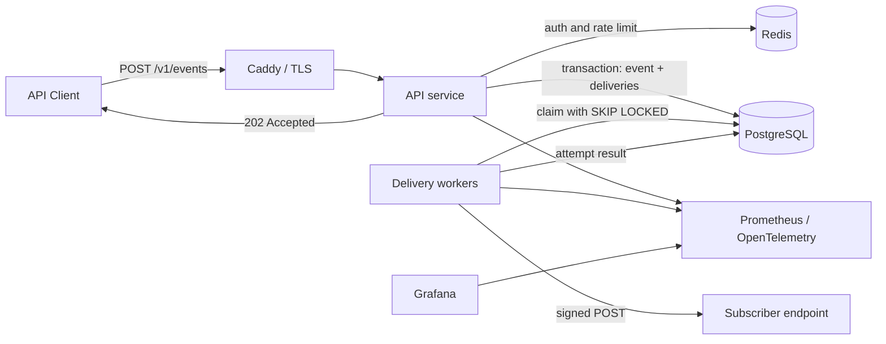

# HookRelay

**Multi-tenant webhook delivery infrastructure written in Go.**

HookRelay ingests application events through a small HTTP API, fans them out to tenant-defined endpoints, signs every request, and retries failed deliveries with exponential backoff. It is built as a production-shaped portfolio project: the interesting part is not the CRUD, but the failure handling.

> **Status:** architecture and delivery plan are complete. Implementation is in progress. This README describes the target system and the contracts it will expose.

---

## Why this exists

Every SaaS eventually needs to tell its customers that something happened: an order was paid, a document was shared, a subscription was cancelled. The naive implementation is a `POST` inside the request handler. It works until a customer is down, slow, or returns `500` forever.

HookRelay treats webhook delivery as infrastructure:

- events are accepted once and stored durably
- delivery is asynchronous and retried
- failures are isolated per tenant and per endpoint
- every attempt is observable
- poisoned deliveries can be inspected and replayed

## Features

- **Event ingestion** with API-key authentication and idempotency keys
- **Endpoint subscriptions** with per-event-type filtering
- **HMAC-SHA256 request signing** with timestamped signatures
- **At-least-once delivery** with exponential backoff and jitter
- **Dead-letter queue** with manual replay
- **PostgreSQL-backed work queue** using `FOR UPDATE SKIP LOCKED`
- **Lease-based crash recovery** for in-flight deliveries
- **Per-tenant rate limiting** backed by Redis and Lua
- **SSRF protection** for subscriber URLs, including DNS rebinding checks
- **Observability** through Prometheus metrics, OpenTelemetry traces, and structured logs
- **Horizontal scaling** with independent API and worker binaries

## Architecture



A deeper design document lives in [`docs/architecture/README.md`](docs/architecture/README.md). It covers the data model, delivery semantics, security model, failure modes, deployment topology, and capacity plan.

## Request lifecycle

1. A tenant sends `POST /v1/events` with an API key and an optional `Idempotency-Key`.
2. The API authenticates the key, applies a per-tenant rate limit, and validates the payload.
3. In one transaction, the API inserts the event and one delivery row per matching endpoint.
4. The API returns `202 Accepted` with the event ID and the number of queued deliveries.
5. A worker claims a batch of due deliveries with `FOR UPDATE SKIP LOCKED`.
6. The worker signs the payload and sends it to the subscriber with a bounded timeout.
7. On success, the delivery is marked `delivered`. On retryable failure, it is rescheduled with backoff. Permanent failures go to the dead-letter state.
8. Every attempt is recorded with status code, latency, and a bounded response snippet.

## Delivery contract

Each request includes:

```text
X-Webhook-Id: evt_...
X-Webhook-Timestamp: 1730000000
X-Webhook-Event-Type: order.created
X-Webhook-Signature: v1=<hex hmac sha256>
```

The signature is computed over:

```text
timestamp + "." + raw_request_body
```

using the endpoint secret. Subscribers should reject timestamps older than five minutes to prevent replay.

### Retry schedule

| Attempt | Delay        |
|---------|--------------|
| 1       | immediate    |
| 2       | 10s ± 20%    |
| 3       | 30s ± 20%    |
| 4       | 2m ± 20%     |
| 5       | 10m ± 20%    |
| 6       | 1h ± 20%     |
| 7       | 6h ± 20%     |
| 8       | 24h ± 20%    |
| 9+      | dead-letter  |

`2xx` is success. `408`, `429`, `5xx`, and timeouts are retryable. Other `4xx` responses are treated as permanent failures because retrying a malformed request is usually pointless.

## Reliability model

HookRelay provides **at-least-once delivery**, not exactly-once delivery. HTTP cannot guarantee exactly-once delivery across a network boundary. The correct contract is:

- the producer deduplicates ingestion with `Idempotency-Key`
- the consumer deduplicates delivery with `X-Webhook-Id`
- the platform retries until success or dead-letter

This is stated explicitly because it drives the whole design.

## Tech stack

| Layer            | Choice                                      |
|------------------|---------------------------------------------|
| Language         | Go                                          |
| HTTP router      | `chi`                                       |
| Database         | PostgreSQL 16                               |
| Database access  | `pgx/v5` + `sqlc`                           |
| Migrations       | `goose`                                     |
| Queue            | PostgreSQL `FOR UPDATE SKIP LOCKED`         |
| Cache / limits   | Redis 7 + `go-redis/v9`                     |
| Logging          | `log/slog`                                  |
| Metrics          | `prometheus/client_golang`                  |
| Tracing          | OpenTelemetry                               |
| Testing          | `testify`, `testcontainers-go`, `httptest`  |
| Load testing     | k6                                          |
| Packaging        | Multi-stage Docker build, distroless image   |
| Deployment       | Docker Compose + Caddy on a VPS (K3s optional) |
| CI/CD            | GitHub Actions + GHCR                       |

## Repository layout

```text
hookrelay/
├── cmd/
│   ├── api/                 # HTTP API binary
│   └── worker/              # delivery worker binary
├── internal/
│   ├── auth/                # API key authentication
│   ├── config/
│   ├── delivery/            # delivery state machine and worker
│   ├── endpoint/            # subscriber endpoints
│   ├── event/               # event ingestion
│   ├── httpapi/             # routes, middleware, handlers
│   ├── observability/       # logs, metrics, traces
│   ├── queue/               # SKIP LOCKED queue
│   ├── ratelimit/           # Redis + Lua limits
│   ├── signing/             # HMAC signing and verification
│   ├── ssrf/                # URL validation and dial-time checks
│   └── tenant/
├── migrations/
├── deploy/
│   ├── docker-compose.yml
│   └── Caddyfile
├── docs/
│   └── architecture/
│       └── README.md
├── loadtest/
├── .github/workflows/
├── Dockerfile
└── Makefile
```

## API sketch

```text
POST   /v1/events                     ingest an event
GET    /v1/events/{id}                read an event
GET    /v1/events?limit=&cursor=      list events
POST   /v1/endpoints                  create a subscription
GET    /v1/endpoints                  list subscriptions
PATCH  /v1/endpoints/{id}             update or pause a subscription
DELETE /v1/endpoints/{id}             delete a subscription
GET    /v1/deliveries?event_id=       inspect deliveries
POST   /v1/deliveries/{id}/replay     replay a dead delivery
GET    /healthz                       liveness
GET    /readyz                        readiness
GET    /metrics                       Prometheus metrics
```

Example ingestion request:

```http
POST /v1/events
Authorization: Bearer whk_live_...
Idempotency-Key: order-123-created
Content-Type: application/json

{
  "type": "order.created",
  "data": {
    "order_id": "123",
    "amount": 9900,
    "currency": "USD"
  }
}
```

Example response:

```json
{
  "event_id": "evt_01J...",
  "deliveries": 3
}
```

## Local development (planned)

```bash
docker compose up --build
curl -s http://localhost:8080/healthz
```

The first implementation milestone will include a seeded tenant, a mock subscriber, and a smoke test that exercises the full ingest-to-delivery path.

## Observability

Key metrics:

- `webhook_ingest_requests_total`
- `webhook_ingest_duration_seconds`
- `webhook_delivery_attempts_total`
- `webhook_delivery_duration_seconds`
- `webhook_queue_depth`
- `webhook_dlq_total`
- `webhook_worker_inflight`

Logs are structured and carry `trace_id`, `tenant_id`, `event_id`, and `delivery_id`. Traces span ingestion, queue claim, HTTP delivery, and the response write-back.

## Roadmap

- [x] Architecture and delivery plan
- [ ] API skeleton, configuration, health checks
- [ ] PostgreSQL schema and migrations
- [ ] API key authentication and tenant isolation
- [ ] Event ingestion and idempotency
- [ ] Endpoint subscriptions
- [ ] Delivery worker with HMAC signing
- [ ] Retry policy, dead-letter state, replay
- [ ] Redis rate limiting
- [ ] SSRF protection
- [ ] Prometheus, OpenTelemetry, Grafana dashboard
- [ ] Integration tests with Testcontainers
- [ ] k6 load test and capacity report
- [ ] Docker image, GitHub Actions, VPS deployment
- [ ] Failure drills and operational runbook

## Documentation

- [Architecture](docs/architecture/README.md)

## License

MIT
