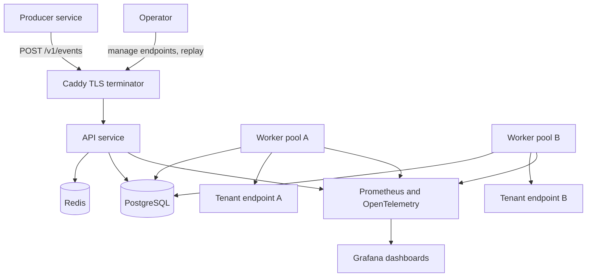
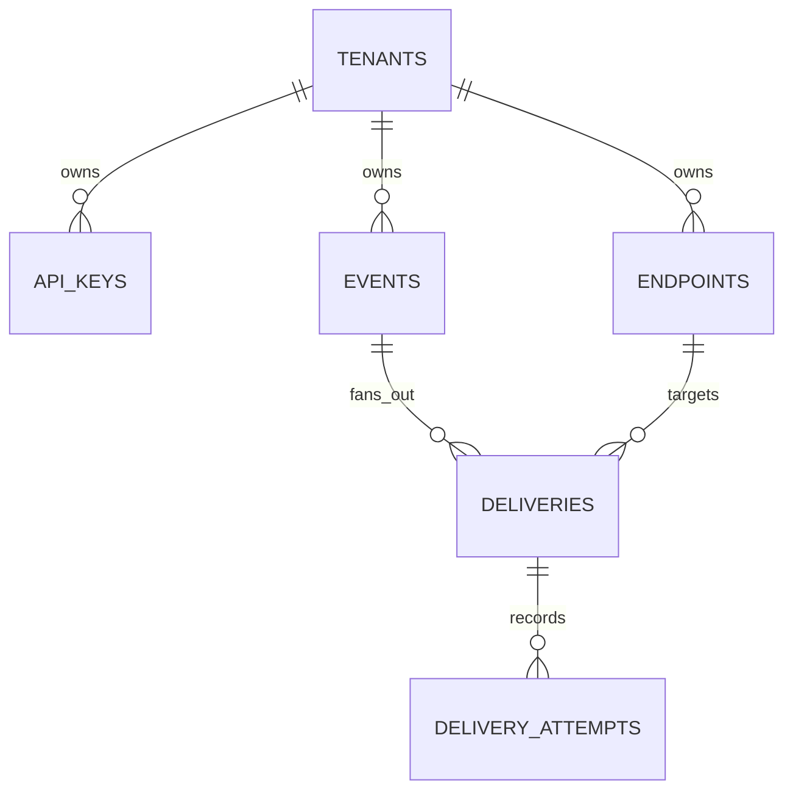
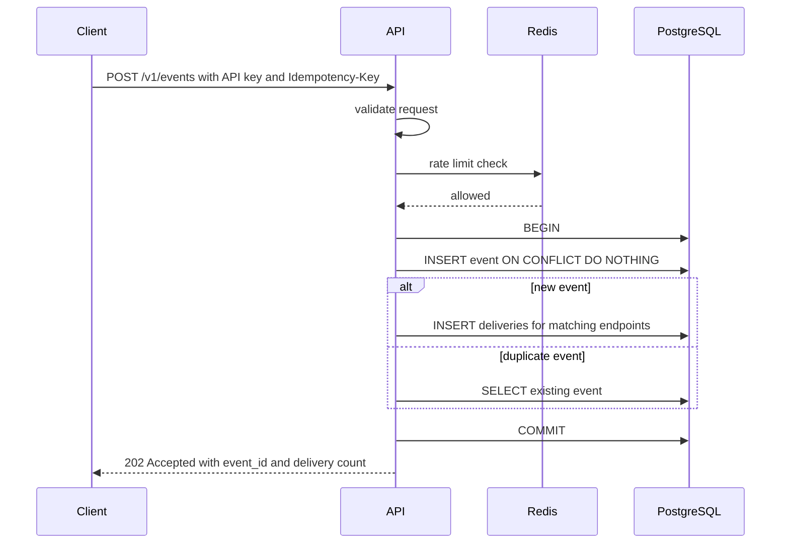
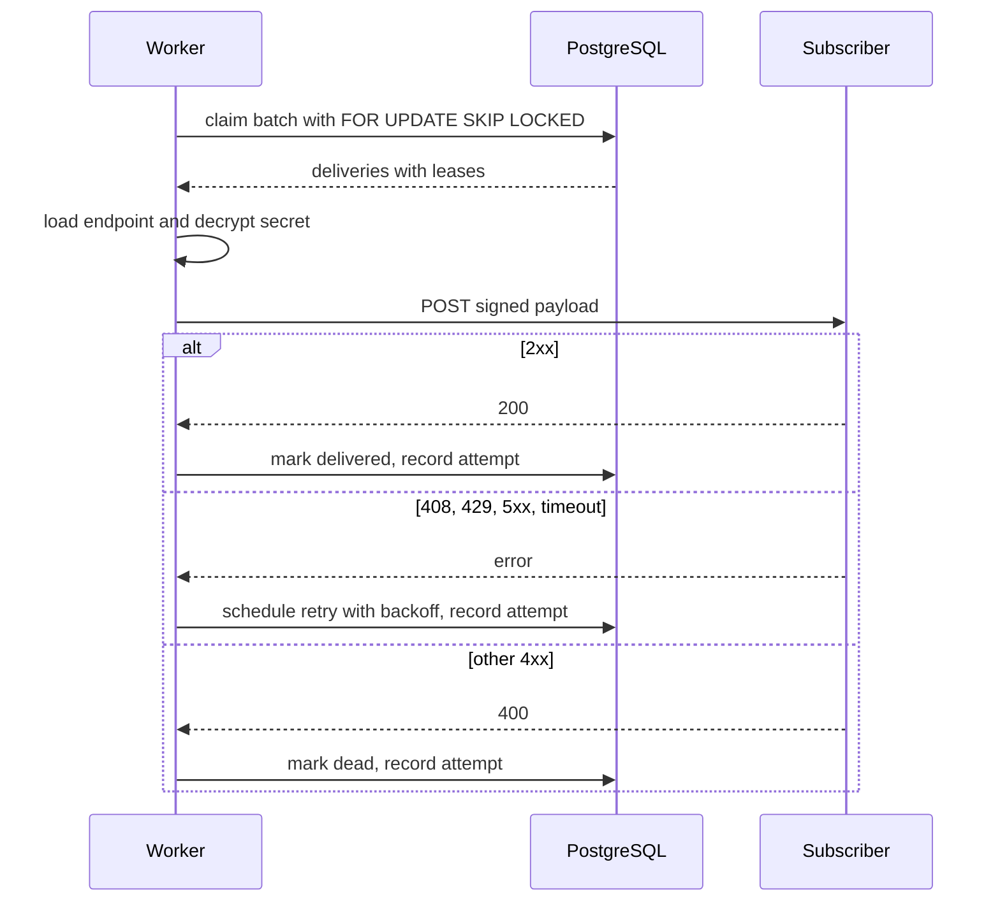
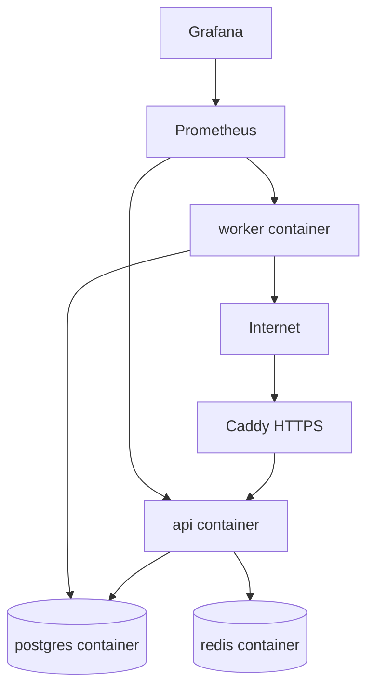

# HookRelay Architecture

This document describes the target design for HookRelay, a multi-tenant webhook delivery service written in Go. It is intentionally detailed: the project is meant to demonstrate system design, reliability engineering, and operational thinking, not just CRUD.

> **Status:** design complete. Implementation is tracked in the repository roadmap.

---

## 1. Goals

- Accept events through a small, well-documented HTTP API.
- Deliver events to tenant-defined HTTPS endpoints.
- Guarantee durable acceptance: an accepted event must not be lost.
- Provide at-least-once delivery with bounded retries and a dead-letter state.
- Isolate tenants from each other for security, fairness, and failure containment.
- Make every delivery attempt observable and debuggable.
- Run on a single small VPS and scale horizontally without redesign.
- Keep the operational surface small enough for one engineer to own.

## 2. Non-goals

- Exactly-once delivery over HTTP. This is impossible to guarantee end to end.
- General-purpose message streaming. HookRelay is not Kafka.
- Arbitrary workflow orchestration. It delivers events, not business processes.
- Multi-region active-active in the first version.
- A full customer-facing dashboard in the first version. The API and metrics come first.

## 3. System context



The system has two runtime roles:

- **API**: authenticates tenants, accepts events, manages endpoints, exposes delivery history, and handles replay requests.
- **Worker**: claims due deliveries, signs and sends HTTP requests, records attempts, and schedules retries.

Both roles share the same PostgreSQL database. Redis is used for rate limiting and short-lived coordination, never as the source of truth for events or deliveries.

## 4. Components

### 4.1 API service

Responsibilities:

- API-key authentication and tenant resolution
- Request validation and payload size limits
- Per-tenant rate limiting
- Event ingestion and idempotency
- Endpoint CRUD
- Delivery inspection and replay
- Health and readiness endpoints
- Prometheus metrics and OpenTelemetry traces

The API is stateless. It can be scaled horizontally behind the reverse proxy.

### 4.2 Delivery worker

Responsibilities:

- Claim due deliveries in batches
- Verify endpoint state and tenant quota
- Sign payloads with the endpoint secret
- Send HTTP requests with strict timeouts
- Classify responses as success, retryable, or permanent failure
- Record attempts and schedule retries
- Recover expired leases after crashes

Workers are stateless and can be scaled independently of the API.

### 4.3 PostgreSQL

PostgreSQL is the source of truth for:

- tenants and API keys
- endpoints and signing secrets
- events and ingestion idempotency
- deliveries and attempt history

It also acts as the work queue in the first version. The queue is the `deliveries` table plus a partial index and `FOR UPDATE SKIP LOCKED`.

### 4.4 Redis

Redis is used for:

- per-tenant and per-key rate limiting
- short-lived caches for API-key verification
- optional distributed coordination

Redis is not required for delivery correctness. If Redis is unavailable, ingestion can degrade to a conservative local limiter rather than failing closed for every tenant.

### 4.5 Observability stack

- Prometheus scrapes `/metrics`.
- OpenTelemetry exports traces over OTLP.
- Grafana visualizes ingestion rate, queue depth, delivery success rate, retry volume, and dead-letter growth.
- Structured logs are shipped to Loki or any log aggregator.

## 5. Data model



### 5.1 Tables

```sql
create table tenants (
    id          uuid primary key,
    name        text not null,
    created_at  timestamptz not null default now()
);

create table api_keys (
    id          uuid primary key,
    tenant_id   uuid not null references tenants(id),
    key_prefix  text not null,
    key_hash    bytea not null,
    revoked_at  timestamptz,
    created_at  timestamptz not null default now()
);

create table endpoints (
    id           uuid primary key,
    tenant_id    uuid not null references tenants(id),
    url          text not null,
    secret_enc   bytea not null,
    status       text not null default 'active',
    event_types  text[] not null default '{}',
    created_at   timestamptz not null default now()
);

create table events (
    id               uuid primary key,
    tenant_id        uuid not null references tenants(id),
    type             text not null,
    payload          jsonb not null,
    idempotency_key  text,
    created_at       timestamptz not null default now(),
    unique (tenant_id, idempotency_key)
);

create table deliveries (
    id              uuid primary key,
    event_id        uuid not null references events(id),
    endpoint_id     uuid not null references endpoints(id),
    status          text not null default 'pending',
    attempt_count   int not null default 0,
    next_attempt_at timestamptz not null default now(),
    locked_until    timestamptz,
    last_error      text,
    created_at      timestamptz not null default now(),
    delivered_at    timestamptz
);

create table delivery_attempts (
    id                bigserial primary key,
    delivery_id       uuid not null references deliveries(id),
    attempt_no        int not null,
    status_code       int,
    latency_ms        int,
    error             text,
    response_snippet  text,
    created_at        timestamptz not null default now()
);
```

### 5.2 Indexes

```sql
create index idx_deliveries_claim
    on deliveries (next_attempt_at)
    where status = 'pending';

create index idx_deliveries_stale
    on deliveries (locked_until)
    where status = 'delivering';

create index idx_events_tenant_created
    on events (tenant_id, created_at desc);

create index idx_attempts_delivery
    on delivery_attempts (delivery_id, attempt_no);
```

The partial indexes keep the hot queue small even when the table contains millions of completed deliveries.

### 5.3 Status model

```text
pending -> delivering -> delivered
                      -> pending      (retryable failure)
                      -> dead          (permanent failure or retries exhausted)
```

A background reaper moves `delivering` rows with `locked_until < now()` back to `pending`. This is crash recovery without a separate lock service.

## 6. Event ingestion



Key decisions:

- The event and its deliveries are written in one transaction. There is no dual-write gap.
- The `deliveries` table is the outbox. A separate outbox table is only needed if a second transport such as Kafka is added.
- Idempotency is enforced by a unique constraint on `(tenant_id, idempotency_key)`, not by an in-memory check.
- A duplicate request returns the original event ID and does not create new deliveries.

## 7. Delivery



Delivery rules:

- Maximum request timeout: 10 seconds.
- Maximum response body captured: 4 KiB.
- Redirects are disabled by default. If enabled later, every hop must pass SSRF validation.
- The worker never holds a database transaction open while making an HTTP call.
- Each attempt is recorded, including failures before a request is sent.

## 8. Queue design

The claim query:

```sql
with claimed as (
    select id
    from deliveries
    where status = 'pending'
      and next_attempt_at <= now()
    order by next_attempt_at
    for update skip locked
    limit $1
)
update deliveries d
set status = 'delivering',
    locked_until = now() + interval '60 seconds',
    attempt_count = attempt_count + 1
from claimed c
where d.id = c.id
returning d.*;
```

Properties:

- Multiple workers can claim concurrently without duplicate work.
- `SKIP LOCKED` avoids head-of-line blocking.
- The lease makes worker crashes recoverable.
- The batch size is configurable. A batch of 25 to 100 is a reasonable starting point.
- Workers use a bounded concurrency pool, so a slow subscriber cannot exhaust memory.

Why PostgreSQL instead of Kafka for v1:

- One fewer distributed system to operate.
- The event and delivery rows are transactionally consistent.
- The expected scale fits comfortably with proper indexes.
- The migration path to Kafka is well understood if volume demands it.

## 9. Retry policy and dead-letter queue

| Attempt | Delay        |
|---------|--------------|
| 1       | immediate    |
| 2       | 10s ± 20%    |
| 3       | 30s ± 20%    |
| 4       | 2m ± 20%     |
| 5       | 10m ± 20%    |
| 6       | 1h ± 20%     |
| 7       | 6h ± 20%     |
| 8       | 24h ± 20%    |
| 9+      | dead-letter  |

Jitter prevents synchronized retry storms when a popular subscriber recovers.

Permanent failures go directly to `dead`:

- most `4xx` responses
- invalid URL or blocked destination
- endpoint paused or deleted
- secret decryption failure

Dead deliveries are visible through the API and can be replayed by an operator. Replay creates a new `pending` state and resets the attempt counter, while preserving the attempt history.

## 10. Idempotency

Two different problems share the word "idempotency":

### 10.1 Ingestion idempotency

The producer sends `Idempotency-Key`. HookRelay stores it with the event and returns the original result on retry. This prevents duplicate events when a client retries a timed-out request.

### 10.2 Delivery idempotency

HookRelay provides at-least-once delivery. The subscriber must deduplicate using `X-Webhook-Id`. This is documented in the delivery contract and is the correct design for HTTP.

The platform does not claim exactly-once delivery. It claims:

```text
durable acceptance + at-least-once delivery + idempotent consumers
```

## 11. Multi-tenancy

- Every row that belongs to a tenant carries `tenant_id`.
- Authentication resolves the tenant before any handler runs.
- Every query is scoped by tenant ID.
- API keys are stored as SHA-256 hashes, never plaintext.
- Optional hardening: PostgreSQL row-level security as a second line of defense.
- Per-tenant limits protect the system from noisy neighbors:
  - ingestion requests per minute
  - concurrent deliveries
  - maximum endpoints
  - maximum payload size

## 12. Security

### 12.1 API keys

- Format: `whk_live_<random>`.
- Store only a hash and a short prefix for lookup.
- Support revocation and rotation.
- Never log the full key.

### 12.2 Webhook signing

- HMAC-SHA256 over `timestamp + "." + raw_body`.
- Include the timestamp in the signature to prevent replay.
- Subscribers should reject timestamps older than five minutes.
- Secrets are encrypted at rest with AES-GCM using a master key from the environment or a secret manager.

### 12.3 SSRF protection

Subscriber URLs are attacker-controlled. The worker must:

- allow only `http` and `https`
- resolve the hostname and reject loopback, private, link-local, multicast, and cloud metadata addresses
- re-check the resolved IP at connect time using a custom `net.Dialer.Control` to prevent DNS rebinding
- disable redirects, or validate every redirect hop
- enforce connect and request timeouts
- cap response body reads

### 12.4 Secrets

- No secrets in Git.
- Production secrets come from the platform secret store or a root-readable environment file.
- Database credentials are scoped to the minimum required privileges.
- Container runs as a non-root user with a read-only root filesystem where possible.

## 13. Observability

### 13.1 Metrics

```text
webhook_ingest_requests_total{status}
webhook_ingest_duration_seconds
webhook_delivery_attempts_total{result}
webhook_delivery_duration_seconds
webhook_queue_depth{status}
webhook_dlq_total
webhook_worker_inflight
```

### 13.2 Traces

One trace covers:

```text
ingest request -> transaction -> delivery claim -> subscriber HTTP call -> result write-back
```

Trace attributes include `tenant_id`, `event_id`, `delivery_id`, and `attempt_no`.

### 13.3 Logs

Structured JSON logs with:

- `trace_id`
- `tenant_id`
- `event_id`
- `delivery_id`
- `attempt_no`
- `status_code`
- `latency_ms`

### 13.4 Alerts

- Oldest pending delivery older than 5 minutes.
- Delivery failure rate above 10% for 10 minutes.
- Dead-letter growth above threshold.
- Ingestion 5xx rate above 1%.
- Worker in-flight count pinned at the limit.

## 14. Deployment

### 14.1 Single-VPS topology



This topology is enough to demonstrate a real deployment: TLS, reverse proxy, multiple services, persistent volumes, health checks, and backups.

### 14.2 Kubernetes option

The same images can run on K3s with:

- one `Deployment` for the API
- one `Deployment` for workers
- `Service` and `Ingress`
- `ConfigMap` and `Secret`
- `HorizontalPodAutoscaler` based on CPU or queue depth
- liveness and readiness probes

Kubernetes is optional. The design should not depend on it.

### 14.3 Database operations

- Migrations run as a separate job before the new application version starts.
- Migrations are backward compatible: add columns first, backfill, then remove old columns in a later release.
- Nightly backups with a documented restore drill.
- Connection pool sized per instance, not per request.

## 15. CI/CD

```mermaid
flowchart LR
    Push[git push] --> Lint[golangci-lint]
    Lint --> Test[go test -race]
    Test --> Integration[Testcontainers integration tests]
    Integration --> Build[Docker build]
    Build --> Scan[Trivy image scan]
    Scan --> Registry[Push to GHCR]
    Registry --> Stage[Deploy staging]
    Stage --> Smoke[Smoke test]
    Smoke --> Prod[Deploy production]
    Prod --> Observe[Watch metrics and logs]
    Observe -->|failure| Rollback[Rollback previous tag]
```



Pipeline rules:

- A pull request must pass lint, unit tests, and integration tests.
- Images are immutable and promoted by tag, not rebuilt for production.
- Production deployment uses a rolling or blue-green strategy.
- A failed smoke test or health check triggers rollback.
- The pipeline records the commit SHA and image digest for traceability.

## 16. Capacity and scaling

Baseline assumptions:

- 1,000 events/s at peak
- 3 endpoints per event on average
- 3,000 deliveries/s at peak
- 8 retry attempts in the worst case

Scaling levers:

1. Increase worker replicas and per-worker concurrency.
2. Increase claim batch size, within memory limits.
3. Partition `deliveries` by time or tenant when the table grows beyond tens of millions of rows.
4. Move the queue to Kafka only when PostgreSQL claim throughput becomes the bottleneck.
5. Add read replicas for delivery-history queries.

The design deliberately keeps API and worker separate so each can scale on its own signal.

## 17. Failure modes

| Failure | Impact | Mitigation |
|---|---|---|
| Worker crashes mid-delivery | Delivery stuck in `delivering` | Lease expiry reaper returns it to `pending` |
| Subscriber is slow | Worker slots occupied | Per-request timeout, bounded concurrency |
| Subscriber returns 500 forever | Queue growth for that endpoint | Backoff, dead-letter, per-endpoint isolation |
| Redis is down | Rate limiting degraded | Local fallback limiter, alert |
| PostgreSQL is down | Ingestion and delivery stop | Health checks, managed backups, restart policy |
| Duplicate ingestion request | Duplicate event risk | Unique idempotency key |
| Duplicate delivery | Subscriber processes twice | Documented at-least-once contract, `X-Webhook-Id` |
| DNS rebinding | SSRF bypass | Dial-time IP validation |
| Clock skew | Bad signature timestamps | NTP, five-minute tolerance |
| Poison payload | Repeated failures | Dead-letter after bounded attempts |

## 18. Tradeoffs

### PostgreSQL queue vs Kafka

PostgreSQL wins on simplicity, transactional consistency, and operational cost. Kafka wins on throughput and retention. For this project, PostgreSQL is the right default; the architecture leaves room to add Kafka later without rewriting the API.

### At-least-once vs exactly-once

Exactly-once delivery across HTTP is not achievable. Promising it would be incorrect. At-least-once plus idempotent consumers is the honest and industry-standard contract.

### API and worker in one repository

A single repository keeps the domain model shared and the deployment simple. Separate binaries preserve independent scaling and failure isolation.

### Single region

A single region keeps the first version operable by one engineer. Multi-region delivery introduces cross-region queue coordination and is out of scope.

## 19. Open questions

- Should endpoint secrets support rotation with overlapping validity windows?
- Should deliveries preserve per-endpoint ordering, or is unordered delivery acceptable?
- What is the retention window for events and attempt history?
- Should replay be synchronous or queued as a background job?
- Is a customer-facing dashboard required for the portfolio demo, or is the API plus Grafana enough?

## 20. Milestones

1. **Foundation:** configuration, logging, health checks, migrations, API skeleton.
2. **Ingestion:** tenants, API keys, event ingestion, idempotency.
3. **Delivery:** endpoints, worker, HMAC signing, retry, dead-letter, replay.
4. **Hardening:** rate limiting, SSRF protection, graceful shutdown, integration tests.
5. **Operations:** metrics, traces, Grafana, load test, capacity report.
6. **Delivery pipeline:** Docker, GitHub Actions, deployment, rollback, failure drills.
