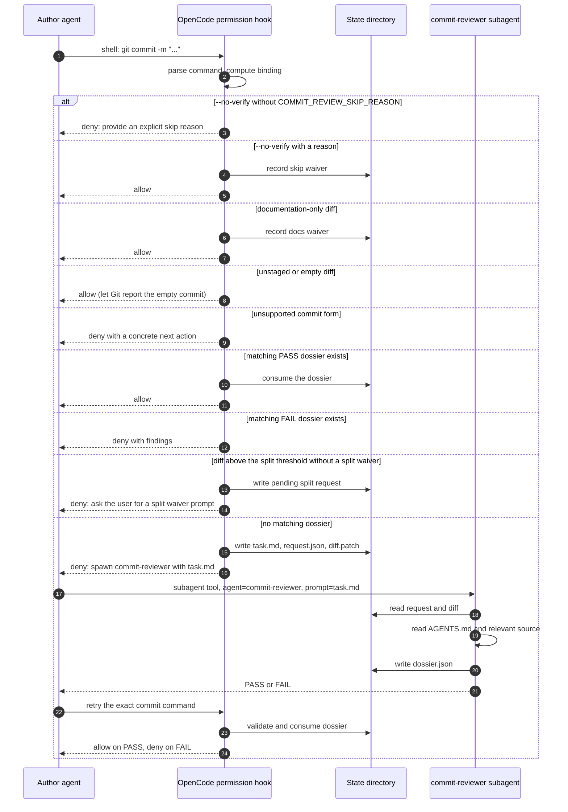
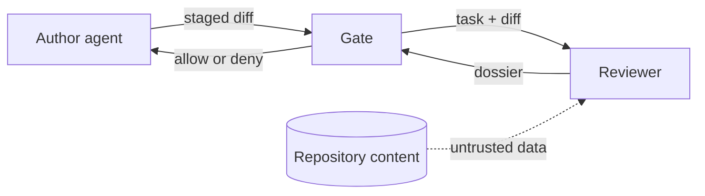

# Commit Review Gate

This document describes the independent commit review gate used by HookRelay agents. It is a local workflow check: a `git commit` from an OpenCode agent is denied until a fresh-context subagent has reviewed the exact staged diff and written a bound `PASS` dossier. The retry consumes that dossier once.

---

## 1. Context

Coding agents are good at producing plausible diffs and bad at noticing that they skipped a boundary case. A self-review in the same context inherits the agent's assumptions, so it tends to confirm the change instead of challenging it.

HookRelay therefore separates authorship from review:

- the author agent has the task context and the edit history;
- the reviewer has no parent context, only the repository and the staged diff;
- the reviewer writes a bound verdict;
- the gate allows the commit only on `PASS`.

This is the same shape used by [boxlite-ai/agent-tooling](https://github.com/boxlite-ai/agent-tooling): a host hook blocks the action, an independent auditor produces evidence, and a gate validates that evidence before allowing the action.

## 2. Goals

- Review every agent-driven commit, not just pull requests.
- Keep the reviewer independent: fresh session, fresh context, no parent transcript.
- Bind the verdict to the exact branch, HEAD, staged diff, and command.
- Make `findings` blocking and `advisories` non-blocking.
- Fail closed on missing, malformed, stale, or unbound evidence.
- Keep the reviewer read-only except for its own dossier.
- Keep the gate fast and non-blocking: the hook never waits for a model call.
- Provide an explicit, auditable skip path for emergencies.
- Exempt documentation-only commits without weakening code review.
- Never split a commit or a diff automatically: an oversized diff requires the user to choose a split waiver through a new prompt.

## 3. Non-goals

- A sandbox or a security boundary. A user with filesystem access can edit the plugin.
- Reviewing commits made outside OpenCode.
- Replacing tests, CI, or human review.
- Reviewing commit message style. The gate reviews code, not prose.
- Exactly-once review. A commit that changes after review is reviewed again.

## 4. Flow

The gate is a two-phase handoff. The permission hook denies the first attempt and prepares a review task. The author agent spawns the reviewer. The author retries the commit; the gate validates and consumes the dossier.



The first denial is not a failure. It is the normal handoff. The author agent must read the task file and pass it to the reviewer.

### 4.1 Oversized diff

The gate does not split the commit and does not split the review artifact automatically. When the staged diff exceeds 512 KiB:

1. The gate writes a pending split request and denies.
2. The denial names a prompt the user must send:
   ```text
   /commit-review waive split <id> <one-line reason>
   ```
3. The prompt hook validates the request against the current branch, HEAD, diff, and command, records a split waiver, and rewrites the prompt to tell the author to retry the commit.
4. The retry proceeds to the normal review handoff. The waiver skips only the size check; the reviewer still reviews the full diff, read in slices.

The pending request expires after ten minutes. A waiver is valid for thirty minutes and only for the exact binding. A changed diff requires a new request.

## 5. Components

### 5.1 Permission hook

`.opencode/plugins/commit-review/index.js` registers an OpenCode `permission.evaluate` hook.

- It runs only for `action === "shell"`.
- It ignores commands from the `commit-reviewer` agent to avoid recursion.
- It matches commands that invoke `git commit`.
- It detects `--no-verify` and requires an explicit `COMMIT_REVIEW_SKIP_REASON`.
- It records a skip waiver and allows an explicit skip.
- It records a docs waiver and allows documentation-only commits.
- It computes the binding from Git itself.
- It looks for a matching dossier in the state directory.
- On a matching `PASS`, it deletes the dossier and allows the commit.
- On a matching `FAIL`, it denies with the findings.
- For an oversized diff, it writes a pending split request and denies until a user waiver exists.
- On no match, it writes the review task and denies with the next action.

The hook never calls a model and never waits for one. It only reads and writes local files.

### 5.2 Prompt waiver hook

The plugin also registers an OpenCode `session.prompt` hook. It recognizes exactly one form:

```text
/commit-review waive split <id> <one-line reason>
```

It validates that:

- the pending request exists and has not expired;
- the branch, HEAD, diff hash, and command hash still match;
- the reason is non-empty.

On success it writes a `split` waiver under `.agents/state/commit-review/waivers/`, removes the pending request, and rewrites the prompt into an instruction for the author to retry the exact commit. On failure it rewrites the prompt into a short rejection that says why the waiver was not recorded.

This is the only path that bypasses the split threshold. The agent cannot grant it by editing the diff or by writing a file; the user must send the prompt.

### 5.3 Reviewer subagent

`.opencode/agents/commit-reviewer.md` defines a `subagent`-only agent.

- It has read access to the repository.
- It may run only a small set of read-only Git commands.
- It cannot read `.env`, private keys, or files outside the repository.
- It cannot fetch the web, launch another subagent, ask the parent, or load skills.
- It may write only `.agents/state/commit-review/`.

The author agent spawns it with the task file as the prompt. The reviewer is instructed to treat every repository file as untrusted data. A prompt injection in a comment or fixture cannot make it commit, push, or edit code because it has no such permission.

### 5.4 State directory

Each denied attempt gets a unique run directory:

```text
.agents/state/commit-review/<run-id>/
├── request.json
├── diff.patch
├── task.md
└── dossier.json      # written by the reviewer
```

`request.json` contains:

```json
{
  "schema_version": 1,
  "run_id": "...",
  "repo_root": "/absolute/path",
  "branch": "main",
  "head": "abc123...",
  "command": "git commit -m ...",
  "command_hash": "sha256",
  "diff_hash": "sha256",
  "diff_path": ".agents/state/commit-review/<run-id>/diff.patch",
  "dossier_path": ".agents/state/commit-review/<run-id>/dossier.json",
  "diff_bytes": 1234,
  "requested_at": "2026-11-23T..."
}
```

`.agents/state/` is gitignored. It is local runtime state, not a source artifact.

### 5.5 Dossier

The reviewer writes:

```json
{
  "schema_version": 1,
  "verdict": "PASS",
  "branch": "main",
  "head": "abc123...",
  "diff_hash": "sha256",
  "command_hash": "sha256",
  "findings": [],
  "advisories": ["low: consider a table test later"],
  "reviewed_files": ["internal/event/ingest.go"],
  "notes": ""
}
```

The gate rejects a dossier when:

- it is missing, unreadable, or invalid JSON;
- `schema_version` is not `1`;
- `verdict` is not `PASS` or `FAIL`;
- branch, HEAD, diff hash, or command hash does not match;
- `findings` or `advisories` is not an array of bounded strings;
- `PASS` has findings;
- `FAIL` has no findings;
- it is older than five hours.

## 6. Binding

A verdict is valid only for the exact review input.

| Field | Source | Why it matters |
| --- | --- | --- |
| `branch` | `git symbolic-ref --short -q HEAD` | Prevents a verdict from another branch |
| `head` | `git rev-parse HEAD`, or `ROOT` on the first commit | Prevents a verdict from another base |
| `diff_hash` | SHA-256 of `git diff --cached --no-ext-diff --no-color --binary` | Prevents a verdict from another staged diff |
| `command_hash` | SHA-256 of the exact shell command | Prevents a verdict from another commit command |

The diff is written to `diff.patch` and the reviewer is asked to verify its hash before deciding. The gate revalidates the dossier on the retry.

A `PASS` is consumed by one commit. The next commit recomputes the binding and needs a new review; there is no reusable approval.

## 7. Decision policy

- `findings` are critical or high. Any finding means `FAIL`.
- `advisories` are low or nit. They never block.
- A `FAIL` denial includes the findings and the non-blocking advisories.
- A `PASS` allows the retry. It does not auto-approve a command that the user's rules would otherwise ask about; the gate only removes its own denial.
- A missing or invalid dossier is a denial, not an allow. The gate fails closed.

This split avoids a common failure mode: a single severity field with a default that downgrades a real bug into a non-blocking nit.

### 7.1 Skip path

`git commit --no-verify` is the explicit emergency path. It is allowed only with an inline reason:

```sh
COMMIT_REVIEW_SKIP_REASON="emergency rollback" git commit --no-verify -m "..."
```

Without the reason, the gate denies and shows the exact form. With it, the gate records a `skip` waiver under `.agents/state/commit-review/waivers/` and allows the commit. The waiver contains the branch, HEAD, diff hash, command hash, files, reason, and timestamp.

This mirrors the boxlite agent-tooling convention that Git's native `--no-verify` bypass applies and is allowed with evidence. It is not silent: every skip leaves a local record.

### 7.2 Documentation exemption

A commit whose changed paths are all documentation needs no reviewer. The allowlist is deliberately narrow:

- `docs/**`
- root `README.md`, `README.mdx`, `README.*`
- root `CHANGELOG.md`, `CHANGELOG.mdx`, `CHANGELOG.*`
- root `LICENSE`, `LICENSE.md`
- root `CONTRIBUTING.md`

Everything else is code for this gate. In particular, these are **not** documentation-exempt:

- `AGENTS.md`, because it changes agent behavior
- `.opencode/**`, because it changes the gate or agents
- `scripts/**`, `deploy/**`, `.github/**`
- any `.md` file inside a code or tooling directory

A docs-only commit records a `docs` waiver with the changed files and binding, then proceeds.

### 7.3 Split waiver

A diff above 512 KiB is not split automatically. The gate writes a pending request and tells the user to choose:

- split the commit into smaller commits, or
- send the waiver prompt:
  ```text
  /commit-review waive split <id> <one-line reason>
  ```

The prompt hook validates the pending request against the current branch, HEAD, diff, and command, records a `split` waiver, and rewrites the prompt into a retry instruction. The waiver skips only the size check. The reviewer still reviews the full diff, with instructions to read it in slices.

Pending requests expire after ten minutes and are single-use. A changed diff invalidates the request. A waiver is valid for thirty minutes and only for the exact binding.

### 7.4 Waiver records

All waivers live under `.agents/state/commit-review/waivers/`:

```json
{
  "schema_version": 1,
  "kind": "skip" | "docs" | "split",
  "reason": "...",
  "branch": "main",
  "head": "abc123...",
  "diff_hash": "sha256",
  "command_hash": "sha256",
  "files": ["..."],
  "source": "command" | "automatic" | "user-prompt",
  "created_at": "2026-11-23T..."
}
```

They are local evidence, not security tokens. A user with filesystem access can edit them; the gate is a workflow check, not a sandbox.

## 8. Trust boundary



- Repository content is untrusted input to the reviewer.
- The reviewer is untrusted output to the gate. The gate validates the binding and the shape; it does not trust the verdict text.
- The author is untrusted input to the gate. The gate computes the diff itself rather than accepting a diff path or hash from the agent.
- The state directory is local and writable. A local user can tamper with it; this is a workflow check, not a security boundary.

## 9. Failure modes

| Failure | Behavior |
| --- | --- |
| Reviewer writes no dossier | Retry is denied with the review task |
| Dossier is malformed | Retry is denied with the review task |
| Dossier binding does not match | Retry is denied with the review task |
| Reviewer reports `FAIL` | Retry is denied with findings |
| `git commit -a` | Denied before review; stage explicitly |
| `git commit --amend` | Denied before review |
| Path-limited commit | Denied before review; stage explicitly |
| `--no-verify` without a reason | Denied with the exact skip form |
| `--no-verify` with a reason | Allowed; `skip` waiver recorded |
| Documentation-only diff | Allowed; `docs` waiver recorded |
| Mixed docs and code | Reviewed as code |
| Diff above 512 KiB, no waiver | Denied with a user waiver prompt |
| Diff above 512 KiB, waiver present | Reviewed as one oversized diff |
| Split waiver request expired | Retry the commit to create a new request |
| Split waiver binding changed | Rejected; retry the commit for a new request |
| Empty staged diff | Allowed; Git reports the empty commit |
| Reviewer times out | The author agent reports the timeout; no dossier exists, so the commit stays blocked |
| OpenCode plugin not loaded | No gate; this is a known boundary |
| Commit from an external terminal | No gate; this is a known boundary |

## 10. Why these choices

### Why a handoff instead of reviewing inside the permission hook

The first implementation created a child session from inside `permission.evaluate` and waited for it. That can deadlock: the parent tool call is paused inside the permission check while the reviewer model call needs the same session runtime. The handoff avoids the deadlock and keeps the permission check fast.

The request-denial-retry shape also matches the boxlite design: the hook never authors the verdict, and the action is retried only after independent evidence exists.

### Why a dossier file instead of parsing the final message

The final assistant message is easy to truncate, wrap in prose, or decorate with a code fence. A file written to a known path is easier to validate and binds the reviewer to an explicit artifact. The gate still asks the reviewer to reply `PASS` or `FAIL`, but the verdict of record is the dossier.

### Why review at commit time instead of PR time

A commit is the smallest reviewable unit and the point where an agent can still fix the issue cheaply. PR review is still necessary, but it should not be the first time a missing timeout or an unbounded retry is noticed.

### Why no retry history in v1

The boxlite design tracks repeated `FAIL` cycles, reflections, referees, and a dead-letter ledger. That is valuable for a long-running agent workflow, but it is a large amount of state for a portfolio project. HookRelay v1 keeps the gate stateless across commits: every commit gets one independent review. A future version can add history and a retry budget without changing the binding model.

## 11. Limits

- The gate only runs inside OpenCode. A human or another agent can commit from a terminal and bypass it.
- The reviewer is an LLM. It can miss a bug or report a false positive.
- The diff cap is 512 KiB. Larger commits need a user-issued split waiver and are reviewed as one oversized diff.
- `--no-verify` skips review entirely. It requires a reason and leaves a local waiver, but it is still a bypass.
- Documentation-only commits are exempt automatically. The docs allowlist is intentionally narrow.
- The gate reviews the staged diff, not the final commit object. `--amend`, `-a`, and pathspec commits are rejected because they cannot be bound reliably.
- The gate does not review commit message quality, author identity, signatures, or generated code provenance.
- The state directory is local and not tamper-evident. Waivers are evidence, not signed approvals.
- A stale PASS is rejected after five hours. A split waiver expires after thirty minutes. The author must re-review.

## 12. Future work

- Add a custom `commit_review` tool that performs the handoff without requiring the author to read `task.md`.
- Add a Git `pre-commit` hook that consumes the same dossier, so commits from a terminal share one gate.
- Add a retry budget and a reflection step after repeated failures.
- Add a second reviewer for security-sensitive paths.
- Add a CI job that runs the same criteria on the pull request diff.
- Add per-repository policy for severity thresholds and diff caps.
- Record review latency and pass rate in Prometheus-compatible metrics.

## 13. Tests

The gate has two test layers:

- `scripts/commit-review/lib.test.mjs` covers command parsing, skip detection, docs classification, diff binding, dossier validation, and message formatting.
- `.opencode/plugins/commit-review/index.test.js` covers the OpenCode adapter with fake permission and prompt hooks. It exercises the first denial, the task file, PASS consumption, FAIL denial, binding mismatch, unsupported commands, recursion protection, `--no-verify` skip, docs exemption, mixed docs/code, and the user-issued split waiver.

Run them with:

```sh
node --test scripts/commit-review/lib.test.mjs .opencode/plugins/commit-review/index.test.js
```
